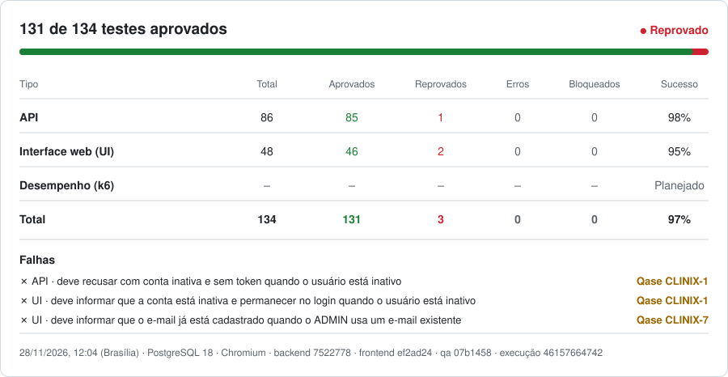

[](https://github.com/clinix-org/clinix-qa/actions/workflows/quality.yml?query=branch%3Adevelop)


# Clinix QA

<a href="https://github.com/clinix-org/clinix-qa/actions/workflows/regression.yml">
  
</a>

<br>

---

## Executar localmente

**Pré-requisitos:** Git, Docker e Node.js 26. No Windows, use o WSL ou o Git Bash.

**1. Baixar os projetos**, lado a lado na mesma pasta

```bash
git clone -b develop https://github.com/clinix-org/clinix-backend.git
git clone -b develop https://github.com/clinix-org/clinix-frontend.git
git clone -b develop https://github.com/clinix-org/clinix-qa.git
```

**2. Subir a aplicação**

```bash
cd clinix-backend
cp -n .env.example .env.local
docker compose up -d --build --wait

cd ../clinix-frontend
docker compose up -d --build --wait
```

**3. Preparar os testes**

```bash
cd ../clinix-qa
npm ci
npx playwright install chromium
npm run env:init
```

No `.env` criado, preencha:

| Variável | Valor |
| :--- | :--- |
| `QA_ADMIN_EMAIL` | `ADMIN_EMAIL` do `clinix-backend/.env.local` |
| `QA_ADMIN_PASSWORD` | `ADMIN_PASSWORD` do `clinix-backend/.env.local` |
| `QA_LOCAL_DB_CONFIRMED` | `true`, após confirmar que o banco do backend é local |

**4. Executar os testes**

| Testes | Comando |
| :--- | :--- |
| Todos | `BASE_URL=http://localhost:8091 npm test` |
| API (Playwright) | `npm run test:api` |
| Interface web (Playwright) | `BASE_URL=http://localhost:8091 npm run test:e2e` |
| Desempenho (k6) | Em breve |
| Abrir o relatório | `npm run report` |
